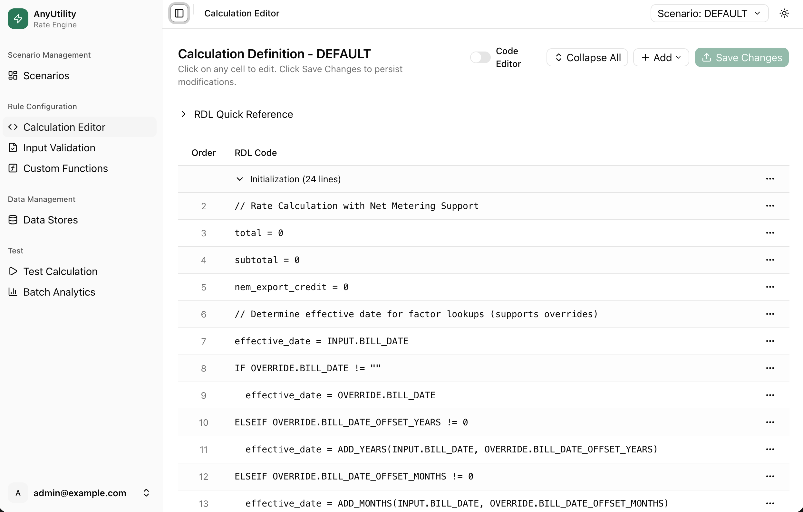
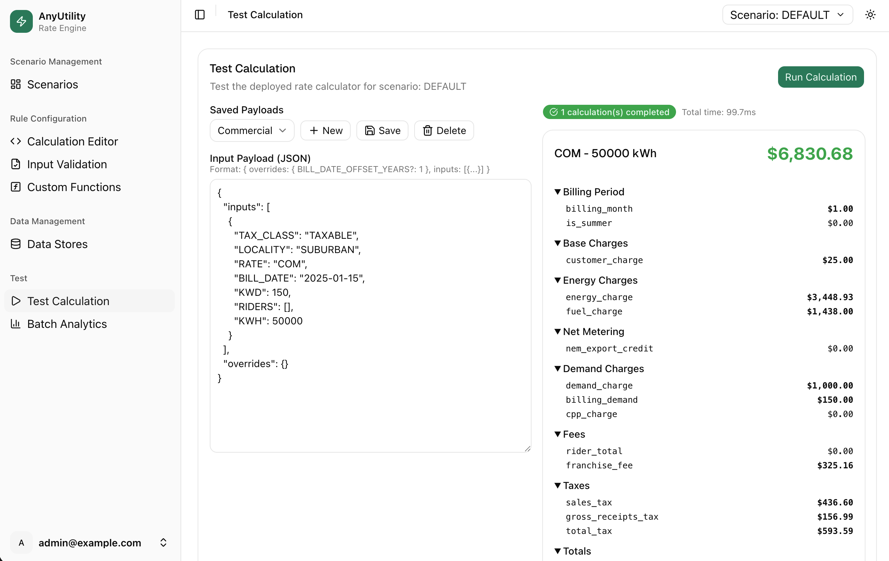
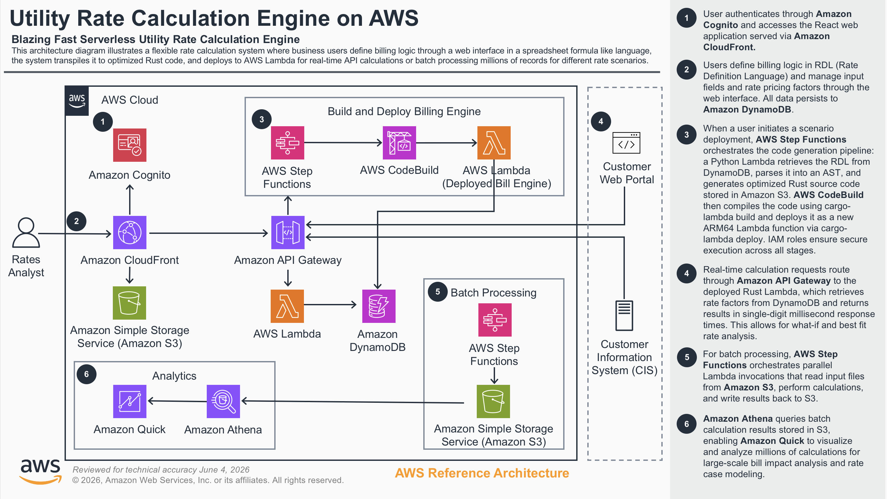

# Energy Utility Rate Engine

> Scenario-driven rate calculation engine for energy utilities — Rust Lambda + React Frontend + AWS Serverless

A sample project that transforms spreadsheet-like rate definitions (RDL) into high-performance Rust Lambda functions for utility bill calculations. Includes a modern web frontend for rate management, scenario-based rate modeling, and batch processing for regulatory analysis.

**Key Innovation**: Business users write rates in simple syntax, the system generates production-ready Rust code, deploys to Lambda, and handles single calculations or millions of calculations for rate case modeling.

**Tech stack**: Full-stack TypeScript — React frontend, AWS CDK infrastructure, and a Node.js API handler — with one deliberate exception: the RDL-to-Rust transpiler is written in Python (the natural fit for grammar/parser/AST work via [Lark](https://github.com/lark-parser/lark)). Rate calculations themselves execute as compiled Rust on ARM64 Lambda for speed.

## The Problem

Energy utilities have **fragmented rate calculation systems**:

| System | Purpose | Problem |
|--------|---------|---------|
| **Website Rate Estimator** | Customer self-service, prorated and projected bills, what-if scenarios, best-fit rate | Different logic than billing, not to-the-penny |
| **Rates Department** | Revenue projections | Months of spreadsheet work, expensive vendors |
| **Back Office** | Dispute resolution | No version control |
| **Core Customer Information Systems** | Production | several month change cycles |

**Result**: Inconsistencies, inability to model rate changes quickly, business users don't own rate logic.

## The Solution

A **single source of truth** for rate calculation. Rates are authored once in a readable language, then run two ways from the *same* compiled logic:

- **API mode (real-time)** — website estimators, call-center and back-office tools.
- **Batch mode (scales with concurrency)** — rate-case modeling, what-if analysis, and best-fit studies across the full customer base, from thousands to hundreds of millions of bills.

### Key Features

1. **RDL (Rate Definition Language)** — spreadsheet-like syntax that business users can read and modify
2. **Scenario-Driven** — test rate changes before deployment (DEFAULT, PROPOSED_2028, etc.)
3. **Rust Performance** — compiled to native ARM64 Lambda for sub-millisecond warm execution
4. **Custom Functions** — extension mechanism for utility-specific logic (tiered rates, rounding, seasonal lookups)
5. **Modern Frontend** — React + shadcn/ui with syntax-highlighted editor, visual rate management
6. **Zero Vendor Lock-in** — open source, standard pay for what you use AWS services

## Use Cases

- **Customer-facing rate estimator** — a customer enters usage and sees a to-the-penny bill, the *same* logic as production billing rather than a separate approximation.
- **Projected & prorated bills** — show a customer their expected month-end or mid-cycle bill from usage so far, using the real rate logic.
- **Best-fit rate** — model a customer's history across every eligible rate to recommend (or, where regulators mandate it, proactively notify them of) a better-suited rate class. See [docs/rate-case-approach.md](docs/rate-case-approach.md#best-fit-rate-analysis).
- **What-if analysis** — compare scenarios side by side ("what would my bill be on the TOU rate, or under next year's rates?").
- **Regulatory rate-case modeling** — recalculate the entire customer base under proposed rates and quantify revenue and per-customer impact. See [docs/rate-case-approach.md](docs/rate-case-approach.md).
- **Back-office dispute resolution** — call the API with specific billing parameters to get a detailed, itemized charge breakdown.
- **Production billing supplement** — the core system (CC&B, SAP, etc) owns customer data while the engine computes charges via API.

## How the Rate Language Works

Rates are written in **RDL (Rate Definition Language)** — a small, line-oriented language designed to read like a spreadsheet formula list, so a rate analyst can follow and edit it without being a programmer. Each line is one of: a variable assignment, a conditional (`IF`/`ELSEIF`/`ELSE`/`ENDIF`), a loop (`FOR … IN … ENDFOR`), an output statement, or a function call. Inputs arrive as `INPUT.<FIELD>`; batch-level projections as `OVERRIDE.<FIELD>`.

Here is the tiered energy charge straight from the seeded `DEFAULT` rate:

```
/// Energy Charge
tier1_rate = GET_FACTOR(INPUT.RATE, "ENERGY_CHARGE", "0", "", "", effective_date)
tier2_rate = GET_FACTOR(INPUT.RATE, "ENERGY_CHARGE", "1000", "", "", effective_date)
energy_charge = CALCULATE_TIERED(INPUT.KWH, 1000, tier1_rate, tier2_rate)
energy_charge = ROUND(energy_charge, 2)
subtotal = subtotal + energy_charge
OUTPUT.INSERT("Energy Charges", "energy_charge", energy_charge)
```

Lines starting with `///` are section headers (shown in the editor's outline); `//` is a comment. Conditionals and loops handle the rest of a real tariff — for example, applying per-kWh riders the customer is enrolled in:

```
FOR rider IN INPUT.RIDERS
  rider_rate = GET_FACTOR("RIDER", rider, "", "", "", effective_date)
  rider_total = rider_total + (INPUT.KWH * rider_rate)
ENDFOR
```

**Where the values come from.** Rate logic (the RDL) is separate from rate *values* (the factors). `GET_FACTOR(key1…key5, date)` looks up a value in the factor store by a hierarchical key, effective on the billing date — so the same RDL produces different bills for different rate classes, localities, and time periods without changing a line of logic. This separation is what makes a rate case a data change, not a code change.

**Custom functions** are the extension point. Each is a named function backed by a small, audited Rust implementation; the RDL calls them by name. The seed set covers common utility math:

| Function | Purpose |
|----------|---------|
| `GET_FACTOR(k1…k5, date)` | Hierarchical, date-effective rate lookup |
| `CALCULATE_TIERED(usage, limit, r1, r2)` / `CALCULATE_TIERED_N(usage, tiers_json)` | Two-tier or N-tier block energy charges |
| `CALCULATE_RATCHET(current, history_json, pct)` | Billing demand under a ratchet clause |
| `POWER_FACTOR_ADJ(charge, actual_pf, target_pf)` | Power-factor penalty on demand |
| `IS_EVENT_DAY(date, events_json)` / `GET_DAY_TYPE(date)` | Critical-peak event days; weekday/weekend |
| `GET_TOU_PERIOD(datetime, schedule_json)` | Map an hour to a time-of-use period |
| `GET_SEASON(date, summer_start, summer_end)` | Season from configurable month boundaries |
| `ROUND_CENTS(value, mode)` | Regulatory rounding (HALF_UP, BANKERS, …) |

At deploy time the RDL is transpiled to Rust, the custom functions are spliced in, and the whole thing is compiled to a native Lambda — so these readable rules execute at compiled-code speed. New functions are added by writing a small Rust body once; rate authors then use them like any built-in.

> Custom function bodies are trusted, developer-authored Rust that is compiled into the calculator. Restrict write access to the custom-functions store to trusted administrators.

## Screenshots

**Calculation Editor** — author rate logic in spreadsheet-like RDL, with a quick reference and per-line editing:



**Test Calculation** — run the deployed Rust calculator against any input and see a full, itemized bill breakdown:



## Architecture



**Key components:**

- 7 DynamoDB tables (scenarios, RDL rules, factors, custom functions, input validation, deployments, test payloads)
- Cognito User Pool with admin-only user creation
- CodeBuild project for Rust cross-compilation (ARM64)
- Step Functions for deployment orchestration and batch processing
- CloudFront distribution with SPA routing

## Batch Processing & Rate-Case Modeling at Scale

The same compiled Rust calculator that answers a single API call also powers **large-scale batch runs** — the capability that makes this engine valuable for the most expensive problem in utility billing: recalculating an **entire customer base** under proposed rates.

A regulatory rate case asks "what happens to revenue and to every customer's bill if we change the rates?" — traditionally months of spreadsheet work and outside consultants.

Here is how it works as a batch job: author the proposed rate as a new scenario, run historical usage against both current and proposed rates, and diff the totals. Because each calculation is stateless and runs as compiled Rust, the workload can be run in parallel and the economics are compelling. Using the seed rate:

- **180 million bills** (5M customers × 36 months) cost **about \$0.23 in Lambda compute**.
- Measured throughput reaches **~122,000 calc/sec** from a laptop driving just 16 concurrent invocations; the architecture can scale to 1,000+ concurrent workers via a Step Functions Distributed Map.
- The same projection logic that powers rate cases also drives website bill estimates, what-if comparisons, and **best-fit rate** analysis (modeling a customer's history across every eligible rate to find — or, where mandated, to proactively notify them of — a better-suited rate class).

**See [docs/rate-case-approach.md](docs/rate-case-approach.md)** for the full guide: date-override projections, scaling configuration, measured benchmarks, best-fit analysis, and Athena/QuickSight integration for impact reporting.

## Prerequisites

- Node.js 22+
- AWS CLI configured with credentials
- Python 3.13+ (for seed data loading and the RDL-to-Rust transpiler)

## Deployment

From the project root:

```bash
./scripts/deploy.sh --seed-data
```

This script performs the following steps in order:

1. **Validates prerequisites** — checks Node.js, npm, AWS CLI, and credentials
2. **Builds the Lambda** — compiles TypeScript API handler (`cdk/lambda/`) to `cdk/lambda/dist/`
3. **Builds the frontend** — runs Vite production build (`frontend/dist/`)
4. **Deploys CDK stack** — creates all AWS resources (~5 minutes)
5. **Writes frontend config** — injects Cognito User Pool ID and Client ID into `config.js`
6. **Uploads frontend to S3** — syncs built assets to the website bucket
7. **Invalidates CloudFront** — ensures fresh content is served
8. **Creates admin user** — with a temporary password that must be reset on first login
9. **Seeds DynamoDB tables** (with `--seed-data` flag):
   - 1 scenario (DEFAULT) with a complete residential/commercial rate calculation
   - 144 RDL lines covering tiered energy, demand (ratchet + power factor + cap), CPP, riders, net metering, fuel, franchise fees, and taxes
   - 42 rate factors with date-effective pricing (2025 + 2026 rates)
   - 19 custom functions (GET_FACTOR, CALCULATE_TIERED, CALCULATE_RATCHET, POWER_FACTOR_ADJ, IS_EVENT_DAY, ROUND_CENTS, etc.)
   - 12 input validation rules
   - 10 test payloads (residential, commercial, net metering, ratchet/power factor, critical peak + riders, future rates, batch)

After deployment, the script outputs the CloudFront URL and admin credentials. The admin password is temporary and must be changed on first login.

### First Login

1. Open the CloudFront URL shown in the deploy script output
2. Sign in with the admin credentials shown in the deploy script output
3. You'll be prompted to set a new password

## Usage Walkthrough

After deploying with `--seed-data`, the system comes pre-loaded with a working rate calculation. Here's how to explore and extend it:

### 1. Review the Seeded Scenario

Navigate to **Scenarios** in the left sidebar. You'll see the `DEFAULT` scenario — this is the production rate structure with date-effective pricing.

### 2. Explore the Configuration

- **Calculation Editor** — the seeded `DEFAULT` rate as ~144 lines of RDL (customer charge, tiered energy, fuel, net metering, demand with ratchet/power-factor/cap, CPP, riders, franchise fee, taxes with exemptions, minimum bill), with syntax highlighting and a `///` section outline. See [How the Rate Language Works](#how-the-rate-language-works).
- **Data Stores** — the rate *factors* (values) behind `GET_FACTOR`, each with an effective date range.
- **Input Validation** — the input fields the rate accepts (e.g. `KWH`, `KWD`, `RATE`, `BILL_DATE`, `LOCALITY`).
- **Custom Functions** (read-only) — the Rust-backed functions the RDL can call.

### 5. Deploy the Scenario

Go to **Scenarios**, select `DEFAULT`, and click **Deploy**. This triggers the deployment pipeline:

1. **GENERATING** — RDL is parsed and converted to Rust source code
2. **BUILDING** — CodeBuild compiles the Rust code to an ARM64 Lambda binary (~7 min first time, ~2 min cached)
3. **SUCCEEDED** — Lambda `RateCalculator-DEFAULT` is deployed and API Gateway route `/api/calculate/DEFAULT` is configured

You can monitor progress on the Scenarios page. The first build takes longer because it installs the Rust toolchain and compiles all dependencies from scratch. Subsequent builds use the CodeBuild S3 cache.

### 6. Test a Calculation

Go to **Test Calculation**. Select a test payload (e.g., "Full Residential") and click **Run**. The system calls the deployed Rust Lambda and returns a detailed bill breakdown:

```
Customer Charge:     $8.99
Energy Charge:     $132.85
Fuel Charge:        $52.82
Demand Charge:     $108.50
Franchise Fee:      $18.19
Sales Tax:          $22.49
Gross Receipts Tax:  $8.09
─────────────────────────
Total:             $351.93
```

Try different test payloads to see net metering credits, commercial rates, tax exemptions, and future rate projections.

### 7. Modify and Redeploy

To make changes:

1. **Edit RDL** — modify the calculation logic in the Calculation Editor
2. **Update factors** — change rates in Data Stores (e.g., increase energy charge by 5%)
3. **Add inputs** — define new input fields in Input Validation
4. **Redeploy** — click Deploy on the Scenarios page to compile and deploy the updated logic

### 8. Batch Processing

Go to **Batch Analytics** to run calculations against large datasets:

1. Upload a JSONL file (one calculation input per line)
2. Select the scenario to calculate against
3. Start the batch — Step Functions orchestrates parallel Lambda invocations
4. Download results as CSV

To test batch throughput, provide your own JSONL file with one calculation input per line, matching the input schema (e.g., `RATE`, `KWH`, `BILL_DATE`, `LOCALITY`, `TAX_CLASS`).

### 9. Create a New Scenario (Rate Modeling)

To model a rate change:

1. Go to **Scenarios** → **Create Scenario**
2. Name it (e.g., `PROPOSED_2025`) and select **Copy from DEFAULT**
3. This copies all RDL lines, factors, and input validation
4. Modify the factors (e.g., increase all energy charges by 5%)
5. Deploy the new scenario
6. Run batch processing against both DEFAULT and PROPOSED_2025
7. Compare results for revenue impact analysis

## Testing

```bash
# Python: RDL parsing + Rust code generation (fast, ~90 unit tests)
python3 -m pytest tests/test_dsl_generator.py -q

# Python: end-to-end — generates the real Rust Lambda from seed RDL, compiles it,
# and asserts to the penny accurate bill totals (requires the Rust toolchain; slow, ~4 min)
python3 -m pytest tests/test_calculation_e2e.py -q

# CDK stack + IAM least-privilege assertions
cd cdk && npm test

# API handler routing/validation
cd cdk/lambda && npm test

# Frontend unit tests + RDL validator
cd frontend && npm test
```

The end-to-end and Rust-function tests build directly from the shipped seed data, so
they cannot drift from the deployed implementations.

To benchmark the deployed calculator at scale (requires a deployed stack and at least
one deployed scenario), see [`scripts/scale_test.py`](scripts/scale_test.py):

```bash
python3 scripts/scale_test.py          # 10k -> 5M throughput/cost ladder
```

## Cleanup

To tear down all resources and stop incurring charges:

```bash
cd cdk && npx cdk destroy
```

Note: the DynamoDB tables use `DeletionPolicy: Retain` so seed and rate data survive a
stack delete. After `cdk destroy`, delete the retained tables manually (or change the
removal policy before deploying if you want them removed automatically). Also empty and
delete the S3 buckets (artifacts, batch data, website) and remove any `RateCalculator-*`
Lambda functions created by the deployment pipeline, since those are provisioned outside
the CDK stack.

## Performance

Measured against the deployed `RateCalculator-DEFAULT` Rust Lambda (ARM64,
2048 MB, `provided.al2023`) in `us-east-1`, invoked directly via the AWS CLI with
billed-duration read from the CloudWatch `REPORT` line. Numbers will vary by
region, rate complexity, and payload size.

### Single-calculation latency

| Metric | Measured |
|--------|----------|
| Warm execution (single bill) | **~1.1 ms** (1.09–1.25 ms over 5 runs) |
| Cold start | **~125 ms init + ~91 ms first exec** (~216 ms billed, one-time) |
| Peak memory used | **40 MB** of 2048 MB provisioned |
| Accuracy | To the penny perfect (verified by the end-to-end test suite) |

> The 40 MB peak usage shows the calculator is heavily over-provisioned at 2048 MB.
> Memory is set high because Lambda scales vCPU with memory; for steady batch
> workloads you can tune memory down to trade a little latency for lower cost.

### Batch throughput

Measured (16 concurrent invocations from a laptop): 1M bills in ~10 s, 5M in ~41 s, at **about \$0.0013 per 1M calculations** — steady as volume grows. Reproduce with [`scripts/scale_test.py`](scripts/scale_test.py); see [docs/rate-case-approach.md](docs/rate-case-approach.md#measured-performance) for the full benchmark ladder and rate-case projections (e.g. 180M bills for about \$0.23).

## Cost

Estimates for **us-east-1** using on-demand pricing, with the calculator's compute
cost taken from the measured batch runs above. A sample deployment at rest (no
traffic) costs only a few dollars/month — almost entirely the things that run
continuously (CloudFront, Cognito, DynamoDB at-rest). Actual cost depends on traffic
and data volume.

| Component | Cost driver | Notes |
|-----------|-------------|-------|
| Lambda (Rate calculator) | **about \$0.0013 per 1M calculations** | Rust ARM64, 2048 MB. ~97 GB-s per 1M bills + request cost. Tuning memory down lowers this further. |
| Lambda (API handler) | Per request | Node.js 22, 512 MB; only on API/admin traffic |
| DynamoDB | Pay-per-request | 7 tables; at-rest cost is just stored bytes (rates/config, not customer data) |
| API Gateway | Per request | REST API; no cost when idle |
| CloudFront | Per GB + requests | Static frontend; pennies at low traffic |
| Step Functions | Per state transition | Deployment pipeline + batch orchestration; pay-per-run |
| CodeBuild | Per build-minute | Only when a scenario is deployed (~2–7 min ARM64 build) |
| S3 | Per GB + requests | Build artifacts + batch input/output |
| Cognito | Per MAU | Free tier covers a handful of admin users |

> **Headline:** because each calculation is short, compiled Rust, a full rate-case
> sweep of **hundreds of millions of bills costs only a few dollars in compute** —
> a one-time, predictable spend rather than standing infrastructure.

## Seed Data

All seed data is completely synthetic — no real utility data is included. The rate structures are representative of typical US residential and commercial electric rates:

- **Residential (RES)**: Customer charge + inverted-block tiered energy (higher rate above 1,000 kWh) + fuel + demand + taxes
- **Commercial (COM)**: Higher customer charge + declining-block tiered energy (lower rate above 1,000 kWh) + demand with ratchet/power-factor/CPP + taxes
- **Localities**: METRO (6% franchise fee) and SUBURBAN (5.5% franchise fee)
- **Tax classes**: TAXABLE, GOVERNMENT (exempt), NONPROFIT (exempt), RELIGIOUS (exempt)
- **Date ranges**: 2025 rates and 2026 rates (automatic effective-date switching)

## Project Structure

```
├── cdk/                          # AWS CDK infrastructure
│   ├── bin/                      # CDK app entry point
│   ├── lib/stacks/               # Stack definition
│   └── lambda/                   # Lambda function code
│       ├── index.ts              # API handler (Node.js)
│       ├── dsl-generator/        # RDL-to-Rust code generator (Python)
│       │   ├── handler.py        # Lambda entry point
│       │   ├── rdl_grammar.py    # RDL parser
│       │   ├── rdl_transformer.py # AST transformer
│       │   ├── rust_generator.py # Rust code emitter
│       │   └── templates/        # Rust project templates
│       └── batch-processor/      # Batch orchestration (Python)
├── frontend/                     # React + shadcn/ui
│   ├── src/
│   │   ├── components/           # UI components
│   │   ├── services/             # API client services
│   │   └── config/               # Amplify configuration
│   └── public/config.js.example  # Runtime config template (deploy.sh writes the live config.js)
├── scripts/
│   ├── deploy.sh                 # Deployment script
│   ├── scale_test.py             # Throughput/cost benchmark at scale
│   └── seed_data/                # Initial data for DynamoDB tables
└── docs/                         # Architecture diagram + rate-case guide
```

## Important

This is sample code for demonstration and educational purposes only. It is not intended for production use without additional security, compliance, and operational reviews. You should work with your security and legal teams to meet your organizational requirements before deployment.

Deploying this sample may incur AWS charges for creating or using AWS chargeable resources.

## Security

See [CONTRIBUTING](CONTRIBUTING.md#security-issue-notifications) for more information.

## License

This library is licensed under the MIT-0 License. See the [LICENSE](LICENSE) file.
